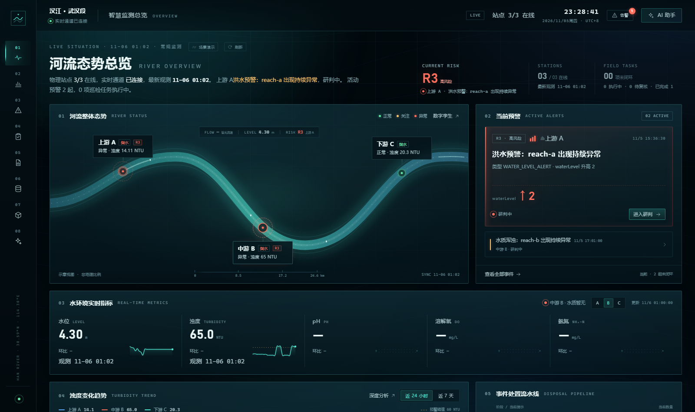
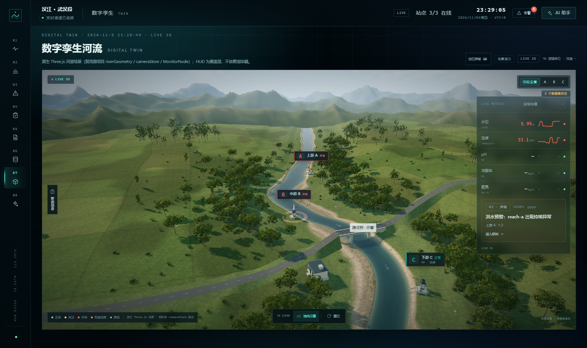
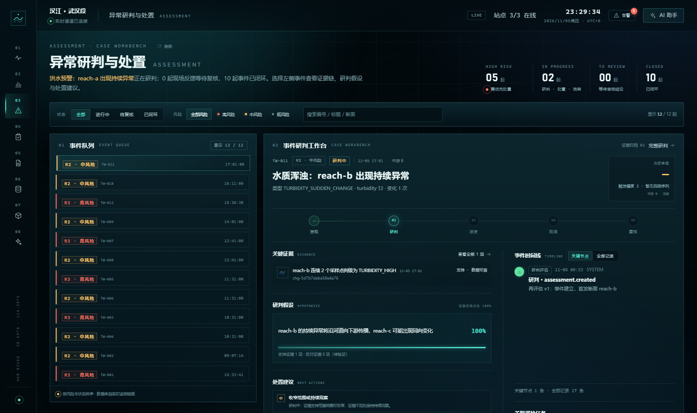
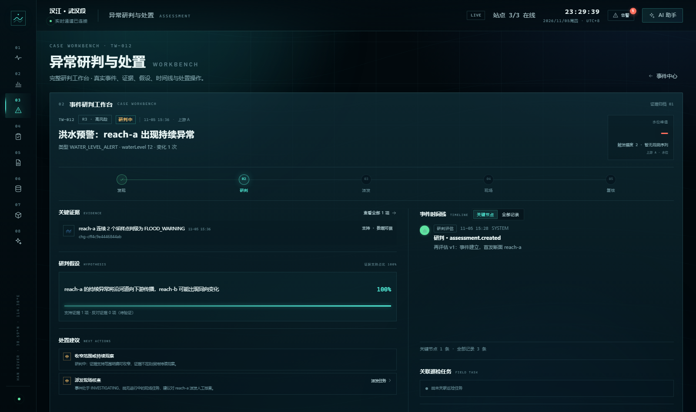
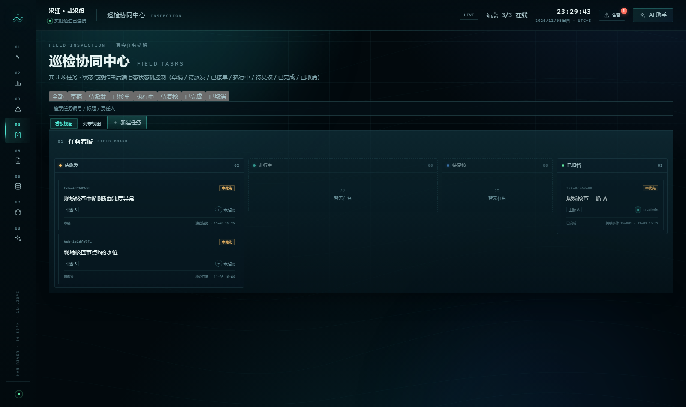
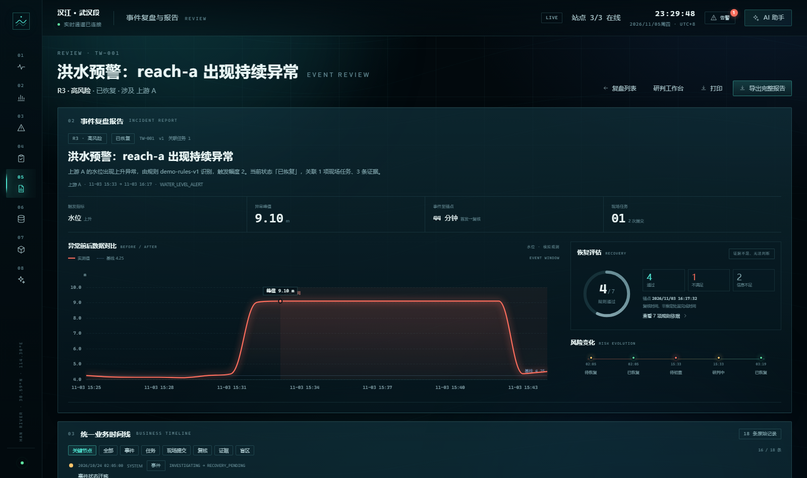
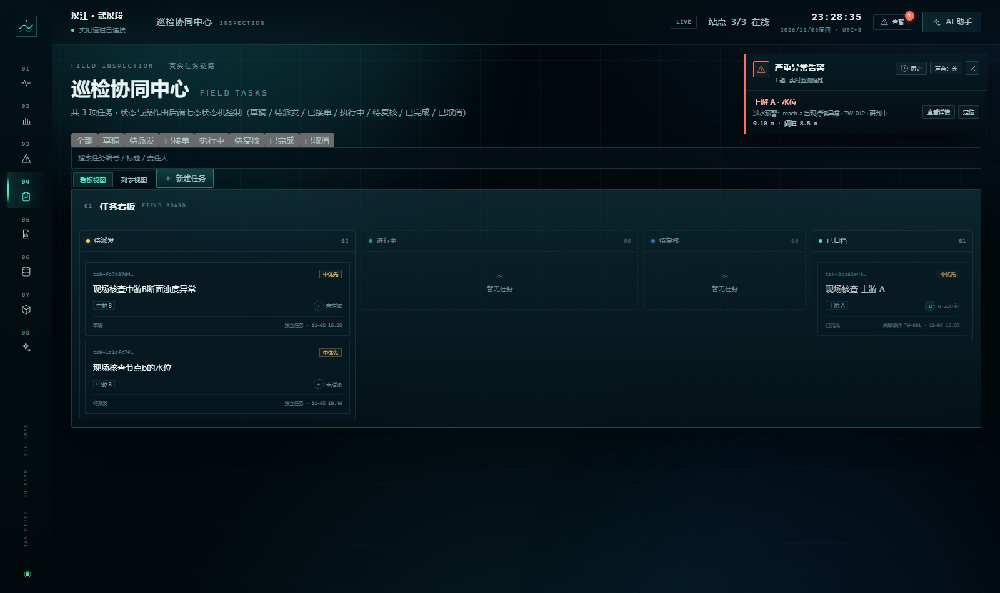

# TideWatch V1.0

**汉江武汉段多断面异常演化研判与巡检辅助系统**（竞赛作品）

TideWatch 把 **观测 → 变化识别 → 活动事件 → 时序关系 → 证据/假设 → 观察重点 → 巡检 → 复核 → 事件复盘** 串成一条可追溯、可复核的工作流。它不是单纯的数据大屏，而是帮助使用者回答「异常如何被确认、范围为何变化、证据支持什么结论、现场任务是否闭环」的辅助研判原型。

> **当前代码基线**：分支 `fusion/f2-overview-migration`，功能提交 `2fa77e2`（2026-11-05）；PDF 字体替换见 `bc1000a`，本文档收口提交见仓库最新历史。
> 本文所有命令均按当前仓库实际脚本核对；未实际执行的验证项会明确标注「未验证」。

> **参赛说明**：本项目参加 **2026 传智杯 Vibecoding 个人赛**，由参赛者独立完成选题、架构取舍、功能验收与文档整理。AI 作为辅助工具参与代码草拟、测试与文档协作；所有生成结果均经过人工审查、实际运行验证与问题纠偏，相关过程见第 14 节与 `docs/contest/GIT_HISTORY.md`。本项目不设团队分工表。

> **数据原则**：官方公开月报（月度水质类别）+ 官方自动站当前快照（默认关闭、手动拉取）+ 明确标识的 MQTT 模拟连续观测 + 可追溯的人工记录。模拟数据在接口、页面与导出物中显式标注；官方快照只展示当前值，不插值为连续趋势；真实站点坐标与上下游关系未核实前使用逻辑节点 A/B/C 并标注「示意拓扑」。

---

## 1. 项目定位与主要解决的问题

| 问题 | 系统做法 |
|---|---|
| 多源监测数据口径混杂 | 模拟观测、官方月报、官方快照分表存储并在界面标注来源 |
| 异常判定容易抖动 | 连续 2 个超阈值样本确认、连续 3 个正常样本恢复，窗口 300 秒 |
| 事件状态随意跳转 | 后端 8 态事件状态机查表迁移，非法操作返回 409 |
| 事件范围与上下游关系说不清 | 范围版本、跨断面时序关系、观察重点 Focus、监测盲区 |
| 研判结论无法追溯 | 证据/假设、再评估、统一业务时间线、运行轨迹 |
| 现场任务与事件脱节 | 7 态巡检任务、版本化提交、PC 复核、图片按版本回传 |
| 告警信息分散 | SSE/WS 统一推送；全局异常告警（新增/升级/重开/恢复） |

适用角色：监测值班与研判人员、巡检管理人员、现场巡检人员、系统管理员。仓库中没有真实使用单位、部署规模或社会效益数据，本文不作此类声明。

---

## 2. 核心特色

1. **确定性规则 + 显式状态机**：异常检测、事件状态、任务流转均为可单测的规则；AI 只做查询与解释，不控制状态机。
2. **屏幕空间节点标签**：3D 场景只保留地面光圈与异常特效，标签由相机投影在 DOM 层渲染，支持距离缩放、LOD、遮挡与防重叠。
3. **双端实时协同**：PC 使用 SSE，小程序使用 WebSocket，后端同一 Hub 扇出，支持历史补放与断线重连。
4. **全局异常告警**：新增、升级、重开、恢复四类提醒；600ms 合并、8 秒轮询兜底、历史持久化、严重告警可选声音。
5. **数据诚信**：模拟/官方/人工记录分表存储；官方快照默认关闭且不插值；规则阈值标注为教学演示值。

---

## 3. 总体架构

```
官方月报 CSV/XLSX ──► 导入(预览→确认→撤销) ─┐
官方自动站当前快照 ──► 手动拉取(默认关/缓存) ─┤
                                            ├─► FastAPI (Python 3.12)
场景模拟器 S1–S5 / F8Sx ─► Mosquitto ─► MQTT ┘   规则引擎 / 8 态事件机 / 7 态任务
                                                 证据·假设·盲区·复盘 / 统一推送 Hub
                                                        │
                                    ┌───────────────────┴───────────────────┐
                              SSE /api/stream                        WS /api/ws
                                    │                                       │
                        PC Web (React 18 + Vite + R3F)        微信小程序（原生 TS）
```

- PC 与小程序都不直连 MQTT Broker，共用同一后端、数据库与业务模型。
- 核心判断在后端完成；前端只展示与提交动作，不复制业务规则。
- 当前为**本地演示免登录**模式；公网部署前必须恢复 JWT 与角色校验（见第 17 节）。

### 3.1 技术栈

| 层 | 技术 | 版本 |
|---|---|---|
| PC Web | React / TypeScript / Vite | 18.3.1 / 5.6 / 5.4.10 |
| 路由与数据 | react-router-dom / TanStack Query / Zustand | 6.28 / 5.59 / 5.0 |
| 3D | three / @react-three/fiber / drei | 0.169 / 8.17 / 9.114 |
| 图表 / PDF | ECharts / @react-pdf/renderer | 5.5 / 4.9 |
| 后端 | FastAPI / uvicorn / Pydantic / SQLAlchemy | 0.156.8 / 0.54 / 2.14.1 / 2.x |
| 数据库 | SQLite（WAL） | 内置 |
| MQTT | paho-mqtt | 2.1.0 |
| 数据与 ML | pandas / openpyxl / scikit-learn | 3.0.6 / 3.1.5 / 1.9.1 |
| 小程序 | 微信原生小程序 + TypeScript | TS 5.6 |

版本以 `frontend/package.json`、`backend/requirements-lock.txt`、`miniprogram/package.json` 为准。

### 3.2 数据流（简版）

1. 模拟器或设备向 Mosquitto 发布 `tidewatch/v1/{reachId}/observation`。
2. 后端 MQTT 接入负责单位/量程校验、消息幂等、死信、LWT 与 STALE 看门狗。
3. 变化检测在连续样本满足条件时确认异常；事件服务创建活动事件、范围、证据与假设。
4. 事件/任务变化经 StreamHub 推送：PC SSE、小程序 WebSocket；前端使相关查询失效重拉。
5. 巡检任务由 PC 创建/派发，小程序接单、测量、拍照、提交；PC 复核通过或退回。
6. 复盘页读取事件、恢复评估、盲区与时间线，前端生成 PDF 报告。

更完整的接口与字段说明见 `backend/README.md`、`docs/mqtt-protocol.md`。

---

## 4. 目录结构

| 目录 | 说明 |
|---|---|
| `backend/` | FastAPI 后端：规则引擎、8 态事件机、7 态任务、MQTT 接入、REST/SSE/WS、SQLite |
| `frontend/` | PC Web：V2 深色界面、数字孪生、图表、复盘 PDF |
| `miniprogram/` | 微信原生小程序：任务、事件、监测、现场记录 |
| `simulator/` | S1–S5 与 F8S1–F8S4 场景发布器（固定 seed） |
| `data/` | 运行期数据库、上传附件、官方样例 CSV（数据库与上传文件不入库） |
| `docs/` | 协议、验收、演示与语音说明 |
| `docs/contest/` | 参赛用 Git 演进与复现记录 |

---

## 5. 运行环境

| 组件 | 要求 | 是否必需 |
|---|---|---|
| Python | **3.12**（开发机验证 3.12.10） | 必需 |
| Node.js | **20+**（开发机验证 24.21.0） | PC / 小程序类型检查必需；运行 TypeScript 单测建议 Node 22+（本次验证使用 24.21） |
| npm | 随 Node 安装（验证 11.19.0） | 必需 |
| SQLite | Python 内置 | 必需 |
| Mosquitto | 任意 2.x，默认 1883 | **可选**：仅实时模拟链路与场景演示需要 |
| 微信开发者工具 | 稳定版 + 测试号 AppID | 仅小程序需要 |
| 浏览器 | 支持 WebGL 的现代浏览器 | 3D 页面需要；不支持时降级 2D 示意 |

---

## 6. 快速开始

### 6.1 获取代码

```bash
git clone https://github.com/core567/Tidwatch.git
cd Tidwatch
git checkout fusion/f2-overview-migration
```

### 6.2 后端

Windows（Git Bash / PowerShell 均可，命令按 Git Bash 写法）：

```bash
cd backend
py -3.12 -m venv .venv
.venv/Scripts/python.exe -m pip install -r requirements.txt

# 配置：复制模板后按需修改（.env 已被 gitignore）
cp .env.example .env          # Git Bash / macOS / Linux
# copy .env.example .env      # Windows CMD

# 初始化数据库与种子
.venv/Scripts/python.exe scripts/init_db.py
.venv/Scripts/python.exe scripts/seed_data.py

# 启动（小程序真机调试时用 --host 0.0.0.0）
.venv/Scripts/python.exe -m uvicorn app.main:app --reload --host 127.0.0.1 --port 8000
```

macOS / Linux 将 `.venv/Scripts/python.exe` 替换为 `.venv/bin/python`，`py -3.12` 替换为 `python3.12`。

验证：

```bash
curl http://127.0.0.1:8000/api/health
# 期望：{"status":"ok","version":"...","database":"ok"}
```

- 接口文档：http://127.0.0.1:8000/api/docs
- 默认数据库：仓库根 `data/tidewatch.db`（可通过 `DATABASE_URL` 覆盖）

### 6.3 PC Web

```bash
cd frontend
npm install
npm run dev        # http://localhost:5173 ，/api 由 Vite 代理到 8000
```

本地演示模式免登录，打开后直达智慧监测总览。生产构建：`npm run build`。

### 6.4 微信小程序

1. 微信开发者工具导入 **`miniprogram/`** 目录（独立工程，不是仓库根）。
2. AppID 填自己的测试号；`project.private.config.json` 已被 gitignore。
3. 本地设置勾选「不校验合法域名、web-view、TLS 证书」。
4. 安装类型定义并检查：

```bash
cd miniprogram
npm install
npx tsc --noEmit
npm run wxss:check
npm run wxml:check
```

5. 后端地址在 `miniprogram/config/env.ts`：
   - 模拟器：`HOST = '127.0.0.1'`，后端监听 127.0.0.1 即可；
   - 真机调试：改为电脑局域网 IP，后端用 `--host 0.0.0.0`，防火墙放行 8000；
   - 扫码预览/体验版受测试号域名限制，需要 HTTPS/WSS 与备案域名，**不在当前演示范围**。

### 6.5 MQTT Broker（可选）

仓库中**没有** `mosquitto.conf`；请使用本机安装的 Mosquitto 默认配置或你自己的配置文件：

```bash
mosquitto -v                  # 前台调试（默认 1883）
# 或使用系统服务启动 Mosquitto
```

启用后端订阅：编辑 `backend/.env`，设置 `MQTT_ENABLED=true` 后重启后端。确认 1883 端口监听。

**不使用 Broker 时的功能边界**：

| 能力 | 无 Broker | 有 Broker |
|---|---|---|
| 健康检查、页面浏览、历史数据 | 可用 | 可用 |
| 历史图表（预置观测） | 可用（`seed_demo_observations.py`） | 可用 |
| 模拟实时观测入站 | **不可用** | 可用 |
| S1–S5 / F8 场景演示、故障注入 | **不可用** | 可用 |
| 事件自动生成与实时推送 | 仅能查看已有事件 | 实时可用 |
| 任务创建/派发/复核、复盘、PDF | 可用 | 可用 |
| 全局告警 | 可对已有事件轮询提醒 | 新增事件实时提醒 |

可选：回填 7 天演示观测（不触发事件、不经过 MQTT）：

```bash
cd backend
.venv/Scripts/python.exe scripts/seed_demo_observations.py --days 3 --interval-min 5
# --no-anomaly 仅常规；--reset 删除该脚本回填的记录；--stats 查看统计
```

### 6.6 场景演示命令

后端 `MQTT_ENABLED=true` 且 Broker 已启动时：

```bash
cd simulator
../backend/.venv/Scripts/python.exe run_scenario.py --scenario S1                 # 稳定基线（零事件）
../backend/.venv/Scripts/python.exe run_scenario.py --scenario S2 --speed 4       # A→B 单事件
../backend/.venv/Scripts/python.exe run_scenario.py --scenario S3 --speed 6       # A→B→C 范围扩展
../backend/.venv/Scripts/python.exe run_scenario.py --scenario S4 --speed 8       # 反例：B 短异常后回落
../backend/.venv/Scripts/python.exe run_scenario.py --scenario S5 --speed 10      # 监测盲区
```

- 可用场景：`S1–S5` 与 `F8S1–F8S4`（固定 seed，可暂停/加速/重置）。
- 也可在 `/admin` 的场景控制台一键启动/停止。
- 场景与故障注入说明见 `docs/mqtt-protocol.md`。

---

## 7. 环境变量

配置模板：`backend/.env.example`（前端仅 `frontend/.env.example` 中的 `VITE_API_BASE_URL=/api`）。`backend/.env` 不入库。

### 7.1 必需

| 变量 | 默认 | 说明 |
|---|---|---|
| `JWT_SECRET` | 示例值 | 公网部署必须替换为随机长串；当前演示模式不校验 token |
| `CORS_ORIGINS` | `http://localhost:5173,http://127.0.0.1:5173` | 自定义前端端口时需同步修改 |

### 7.2 可选

| 变量 | 默认 | 说明 |
|---|---|---|
| `DATABASE_URL` | 空（`data/tidewatch.db`） | 自定义 SQLite 路径 |
| `MQTT_ENABLED` | `false` | 是否订阅 MQTT |
| `MQTT_HOST` / `MQTT_PORT` | `127.0.0.1` / `1883` | Broker 地址 |
| `MQTT_TOPIC_PREFIX` | `tidewatch/v1` | Topic 前缀 |
| `MQTT_STALE_SECONDS` | `30` | 超时置 STALE |
| `RULE_VERSION` | `demo-rules-v1` | 规则版本标记 |
| `UPLOAD_DIR` / `MAX_UPLOAD_MB` | `./data/uploads` / `8` | 附件目录与大小限制 |
| `OFFICIAL_AUTO_ENABLED` | `false` | 官方自动站快照拉取 |
| `AI_ENABLED` / `AI_API_KEY` / `AI_BASE_URL` / `AI_MODEL` | 关闭/空 | 四项齐全才启用大模型；否则规则模式 |

> 不要将真实密钥、Token 或密码写入仓库或截图。演示账号密码见 `backend/scripts/seed_data.py` 的种子说明，公网部署前必须修改。

---

## 8. 数据库初始化与重置

```bash
cd backend

# 建表
.venv/Scripts/python.exe scripts/init_db.py

# 种子（断面、指标字典、用户、规则配置）
.venv/Scripts/python.exe scripts/seed_data.py

# 危险：删表重建并重新种子，仅用于本地演示
.venv/Scripts/python.exe scripts/reset_db.py --yes
```

- 默认 SQLite 文件：仓库根 `data/tidewatch.db`，WAL 模式。
- 数据库与上传文件均已被 `.gitignore` 忽略，新环境必须初始化。
- 当前模型共 32 张表（以 `backend/app/models/` 的 `__tablename__` 统计）。
- 历史迁移脚本：`scripts/migrate_v2.py`、`scripts/migrate_notifications.py`；仓库没有 Alembic 目录。

---

## 9. 核心功能与演示路径

| 路径 | 页面 | 主要能力 |
|---|---|---|
| `/` | 智慧监测总览 | 断面状态、实时指标、趋势、告警摘要、巡检看板 |
| `/monitor`、`/river-3d` | 3D 数字孪生 | 节点标签、异常分级、镜头聚焦、HUD |
| `/analysis` | 水环境分析 | 指标矩阵、断面对比、趋势、水质评价 |
| `/events` | 异常研判与处置 | 事件队列、筛选、状态动作 |
| `/events/:eventId/workbench` | 研判工作台 | 证据/假设/时间线/恢复评估/派发任务 |
| `/tasks` | 巡检协同中心 | 草稿/派发/接单/提交/复核/版本历史 |
| `/review` | 事件复盘与报告 | 复盘列表、恢复评估、PDF 导出 |
| `/assistant` | AI 智能助手 | 规则问答、可选大模型、语音输入 |
| `/admin` | 数据与系统管理 | 健康诊断、数据源、场景控制、月报导入、官方快照 |

### 9.1 全局异常告警（F9）

- 入口：V2 顶栏「告警」按钮与告警卡；历史面板持久化在浏览器本地。
- 触发：事件新增、优先级升级、状态升级、重开、恢复；同一状态重复推送不会重复提醒。
- 声音：严重告警可选短促提示音；浏览器要求先有一次用户手势，刷新后可能需要重新点击开启。
- 抽屉/弹窗打开时，告警卡收起到左上角并折叠明细，避免遮挡表单；告警同时进入历史。
- 数据来源：复用现有 SSE 总线与事件 API，不新建事件系统；手动状态操作由 8 秒轮询兜底。
- 阈值展示读取后端 `/api/admin/diagnostics` 的 `ruleParams`，接口失败时回退 `demo-rules-v1`。

### 9.2 异常研判

- 8 态：`OPEN / INVESTIGATING / MONITORING / ESCALATED / NARROWED / RECOVERY_PENDING / RECOVERED / UNRESOLVED`。
- 人工动作与规则自动迁移共用同一状态表；非法迁移返回 409。
- 工作台支持证据/假设、时间线、恢复评估、盲区、派发任务。

### 9.3 巡检闭环

- 7 态：`DRAFT / PENDING / ACCEPTED / IN_PROGRESS / SUBMITTED / APPROVED / CANCELLED`。
- 提交生成版本记录；退回必须填写原因并回到进行中；照片与测量按版本隔离。
- PC 与小程序的提交/复核记录来自同一后端。

### 9.4 数字孪生

- 程序化生成的示意河道 3D 场景（非 GIS、非真实地形测绘）。
- 节点标签为屏幕空间长方形 DOM：距离缩放、滞回 LOD、地形/视锥遮挡隐藏、矩形防重叠。
- 异常五档：正常 / 关注 / 异常 / 恢复观察 / 离线；3D 地面光圈、扩散环、光柱与标签联动。
- 点击节点或「定位异常」触发相机缓动；返回 `/monitor` 时保留上次聚焦断面。

### 9.5 复盘与报告

- 复盘详情包含恢复评估、盲区、趋势对比、统一时间线。
- 前端使用 `@react-pdf/renderer` 生成 PDF 并下载；也可使用浏览器打印。
- 月报统计按导入批次与原始周期聚合。

### 9.6 AI 助手

- 默认规则模式：基于真实数据查询断面、事件、任务、恢复评估、异常列表。
- 可选大模型：OpenAI 兼容接口，仅能调用 6 个只读工具；失败自动降级并提示。
- 语音：PC 使用浏览器 Web Speech API；小程序使用同声传译插件，插件不可用时明确降级为手动输入。
- 边界：不能派发任务、不能修改事件状态、不能复核；写操作必须人工在页面完成。

---

## 10. 数据口径

| 数据 | 存储 | 来源 | 说明 |
|---|---|---|---|
| 连续观测 | `observations` | 场景模拟器 / 外部设备 | 默认 `SIMULATED`，界面标注；不是官方实测 |
| 官方月报 | `official_monthly_records` | 人工导入 CSV/XLSX | 保留月度原始口径 |
| 官方快照 | `official_auto_records` | 手动拉取（默认关闭） | 仅当前值，不插值；平台反爬/网络可能失败 |
| 现场记录 | `attachments`、`task_submissions` | 人工提交 | 按任务版本隔离 |
| 演示模式 | 前端内存 | `v2/demo/` | 刷新即退出，不写数据库 |

**官方连续实时水文/水质接口未接入。** 当前只有「官方月报导入」和「官方自动站当前快照手动拉取」两种官方数据通道。

### 10.1 官方自动站当前快照（OFFICIAL_AUTO）

- **来源**：国家地表水自动监测实时数据发布系统（中国环境监测总站），
  `POST https://szzdjc.cnemc.cn:8070/GJZ/Ajax/Publish.ashx`。
- **口径（2026-10-25 实测）**：平台返回的是当前快照，无公开历史序列；本系统只保存当前值，不插值、不伪造连续趋势。
- **站点映射**（示意关联，上下游对应待核实）：`reach-a ↔ 余家湖`、`reach-b ↔ 转斗`、`reach-c ↔ 新沟闸`。
- **接口**：`GET /api/official/auto?reachId=`、`GET /api/official/auto/status`、`POST /api/official/auto/refresh?force=true`。
- **约束**：默认关闭（`OFFICIAL_AUTO_ENABLED=false`），仅在 `/admin` 手动拉取；同站点 30 分钟缓存、多站查询节流；数据缺失显示「暂无数据」，超过 25 小时标记过期；采集失败写入死信并降级，不影响 MQTT 链路与事件机。
- 官方快照与模拟观测分表存储（`official_auto_records` vs `observations`），禁止互相污染。

> 月报水质类别保留原始月度口径，不插值为小时级曲线；时序先后不等于因果。

---

## 11. 测试与验证状态

### 11.1 已验证（2026-11-05，当前基线）

| 项目 | 命令 | 结果 |
|---|---|---|
| 后端（排除外部 Broker 测试） | `pytest tests --ignore=tests/test_failure_matrix.py` | **165 passed**，18.43s |
| 前端类型检查 | `npm run typecheck` | 通过 |
| 前端构建 | `npm run build` | 通过（约 24–25s，提示 chunk >500kB） |
| 3D/相机单测 | `npm run test:3d` | **60 passed** |
| 告警规则单测 | `npm run test:alerts` | **14 passed** |
| 小程序单测与静态检查 | `npm test` | **55 passed**；WXSS 34 文件 0 错误；WXML 平衡通过 |
| 全局告警运行验证 | 浏览器 + 请求桩（不写库） | 新事件/升级/恢复/去重/历史/已读/关闭/定位/单 SSE 连接均通过 |

后端测试使用内存 SQLite（`tests/conftest.py` 强制 `DATABASE_URL=sqlite://`），不会写入演示库。

### 11.2 未验证

| 项目 | 原因 | 状态 |
|---|---|---|
| `tests/test_failure_matrix.py`（5 项） | 需要外部 Mosquitto；本机 Broker 同时被演示后端订阅，运行会污染演示库 | **未验证** |
| `scripts/e2e_scenarios.py` | 依赖真实 Broker、临时端口与较长时间 | **未验证** |
| 微信小程序真机拍照/上传/提交 | 需要开发者工具、真机与局域网后端 | **未验证** |
| AI 大模型真实调用 | 需要外部服务与有效配置；本文不涉及密钥 | **未验证** |
| 官方自动站真实拉取 | 默认关闭，受平台反爬与网络影响 | **未验证** |
| 浏览器告警声音听感 | 无头环境无法听辨 | **未验证**（需人工确认） |
| 第三方独立复现 | 尚未由第三方执行 | **未验证**，见 `docs/contest/REPRODUCE.md` |

---

## 12. 第三方交叉复现

逐项检查表与记录模板见 [docs/contest/REPRODUCE.md](docs/contest/REPRODUCE.md)。建议顺序：

1. 记录操作系统、Python、Node、npm、浏览器版本。
2. 克隆指定分支，按第 6 节启动后端与 PC 端，记录 `/api/health` 输出。
3. 执行第 11.1 节的测试命令，记录通过/失败/跳过。
4. 无 Broker 时验证总览、任务创建/复核、复盘 PDF、AI 规则模式。
5. 有 Broker 时启动 S1/S2 场景，验证事件生成与 SSE 推送。
6. 导入 `data/samples/wuhan_surface_water_2026-07_hanjiang.csv` 验证月报预览→确认→撤销。
7. 将实际输出、截图与异常信息填入 REPRODUCE.md 的结果表。

> 截至本文，**尚未完成第三方交叉复现**；仓库内只有项目维护者在开发环境的验证记录。

---

## 13. Git 开发演进与关键提交

完整时间线、提交哈希与链接见 [docs/contest/GIT_HISTORY.md](docs/contest/GIT_HISTORY.md)。摘要：

| 阶段 | 时间 | 代表提交 | 内容 |
|---|---|---|---|
| M0 工程基线 | 2026-10-21 | `963df6c` | 三端骨架、FastAPI、SQLite、契约、SSE/WS |
| M1 数据链 | 2026-10-22 | `71700e8` | MQTT 接入、变化检测、3D 镜头与异常联动 |
| M2 事件与研判 | 2026-10-25 | `1fba596`、`413352b` | 8 态事件、工作台、时间线 |
| M3 研判闭环 | 2026-10-25 | `978f6e2`、`ec67479` | 证据/假设、盲区、7 态任务、PC 复核 |
| M4 复盘与交付 | 2026-10-25/26 | `75e386e`、`a5b9981` | PDF 报告、故障矩阵、场景控制台 |
| V2 视觉融合 | 2026-11-01~04 | `cffe6ad`、`8ce000e`、`49a21af`、`a0989ce`、`98354e5` | 统一外壳、3D 孪生、分析、事件、巡检、AI |
| 3D 标签纠偏 | 2026-11-04 | `9949b6f` | 屏幕空间标签、LOD、遮挡、防重叠 |
| 小程序顶部纠偏 | 2026-11-05 | `897a5fc` | 删除重复品牌区，保留通知入口 |
| 巡检弹窗纠偏 | 2026-11-05 | `9825959`、`8e3181f` | 焦点抢占、输入高度、主题作用域 |
| 全局告警 | 2026-11-05 | `607fb40` | 告警中心、通知、声音、历史 |
| 孪生初始视角 | 2026-11-05 | `2fa77e2` | 返回孪生页保留上次聚焦断面 |

全部提交为线性历史，未使用 rebase、amend 或 squash。

### 13.1 里程碑（保留原项目记录）

- **M0** 工程基线：三端工程、Pydantic 契约、规则与状态机、JWT 工具、SSE/WS Hub、种子数据。当时统计 24 张表；当前模型已扩展为 32 张。
- **M1** 数据链：MQTT 去重/乱序/迟到/死信/LWT/看门狗、观测与诊断 API、官方月报预览→确认→撤销、S1 场景、3D 河流全景。
- **M2** 异常事件：滑动窗口变化检测、8 态事件机、跨断面时序关系与 Focus、S2/S3 场景、事件中心、研判工作台（人工操作 + 409）、3D 镜头飞行与异常脉冲。
- **M3** 研判闭环：证据/假设、再评估版本、S4 反例、S5 监测盲区、巡检任务 PC↔小程序闭环、规则 vs ML 对照、月报统计。
- **M4** 联调交付：S1–S5 真实 Broker 端到端回归、故障矩阵 D1–D5、场景控制台、语音转写（可降级手动）、部署与演示文档。
- **M4 之后**：V2 视觉与业务融合（2026-11-01 起）、三次人工纠偏、全局告警与孪生初始视角修复。

---

## 14. AI 辅助开发与人工纠偏（个人赛）

### 14.1 参赛形式与分工

本项目为 **2026 传智杯 Vibecoding 个人赛**作品，由参赛者独立完成：

- 选题、需求边界与演示场景设计；
- 技术选型、架构取舍与状态机/规则设计；
- 在真实界面复现问题、定位原因、确定修复范围；
- 运行测试、构建与人工验收；
- 维护真实 Git 提交历史与参赛文档。

AI 作为辅助工具参与：需求拆解、代码草拟、测试用例草拟、文档整理与核对。AI 生成的代码不会直接视为完成，必须经过人工阅读、运行验证与回归；本项目不设团队成员表或虚构分工。

### 14.2 人工审查与纠偏流程

每个问题按以下步骤处理，并在 Git 中保留真实提交：

1. **真实复现**：在浏览器/接口/小程序中复现，而不是只看代码猜测。
2. **定位根因**：结合源码、日志、焦点变化、计算样式与接口响应判断。
3. **限定修复**：只改必要文件，避免扩大范围；发现需要改架构或后端接口时先停下评估。
4. **回归验证**：运行相关测试、类型检查、构建和实际交互；区分「自动化测试通过」与「仅人工运行验证」。
5. **如实记录**：保留提交顺序与修复过程，不为了好看改写历史。

典型案例：巡检弹窗第一轮只修了颜色，输入仍然异常；人工继续反馈并记录按键后的焦点变化，才定位到 Drawer effect 每次重渲染抢占焦点，以及全局 CSS 的 flex-basis 被解释为高度。这说明 AI 辅助修复必须以人工复现和回归为前提。

| 案例 | 问题 | 修复 | 证据 |
|---|---|---|---|
| 3D 节点可视化 | 场景内标签随镜头变形、重叠、状态单一 | 改为屏幕空间长方形标签，增加缩放/LOD/遮挡/防重叠/五档状态 | [`9949b6f`](https://github.com/core567/Tidwatch/commit/9949b6fab52e5797613ffa1b5a944a6cfc0a5217)，3D 单测 60 项 |
| 小程序顶部层级 | 重复 Logo/标题/副标题占用首屏 | 仅保留通知入口，精简监测总览 | [`897a5fc`](https://github.com/core567/Tidwatch/commit/897a5fca2084713bcaf402d6d50f7f1fef9c0607) |
| 巡检弹窗 | 文字对比度差；随后发现每按一键焦点被抢、标题框高约 200px | 主题作用域与 Drawer 样式；Drawer effect 去依赖、全局 CSS 收敛、42px 单行高度 | [`9825959`](https://github.com/core567/Tidwatch/commit/9825959b37c20d28bb59dfc80e94b95fbfde1507)、[`8e3181f`](https://github.com/core567/Tidwatch/commit/8e3181f6dcf21fff931cd2cb153bf995c79e3d1b) |

> 注意：案例三的实际修复顺序是「先主题对比度、后输入失效」，但 Git 提交顺序为先 `9825959`、后 `8e3181f`，原因是第一轮修复在提交前一直留在工作区。材料中已如实说明，未改写历史。

---

## 15. 截图与演示材料

当前版本截图位于 `docs/screenshots/current/`，统一为 1600×950，采集于**隔离演示环境**：独立数据库副本、独立后端（8002）与独立 MQTT Topic 前缀（`tidewatch-iso/v1`），通过 F8S1 同构场景注入模拟观测，由规则引擎生成事件 `TW-012`；告警由该真实事件触发，未手工修改事件状态，也未写入日常开发库。图中数据均标注为模拟/演示性质。

| 页面 | 路由 | 截图 |
|---|---|---|
| 智慧监测总览 | `/` |  |
| 3D 数字孪生 | `/monitor` |  |
| 事件研判列表 | `/events` |  |
| 研判工作台（TW-012） | `/events/TW-012/workbench` |  |
| 巡检协同中心 | `/tasks` |  |
| 事件复盘（TW-001） | `/review/TW-001` |  |
| 全局异常告警（TW-012 实时触发） | `/tasks` + 告警卡 |  |

说明：

- `docs/screenshots/` 下按阶段归档的旧截图拍摄于 2026-10-25/26，早于 V2 视觉融合，**不作为当前版本展示**，仅保留历史记录。
- 3D 截图为无头浏览器 SwiftShader 渲染，真实显卡下细节可能略有差异。
- 演示视频尚未提供，状态为「待补充」。

演示话术与场景说明见 [docs/demo-script.md](docs/demo-script.md)。

---

## 16. 常见问题排查

| 现象 | 可能原因 | 处理 |
|---|---|---|
| 端口 8000 被占用 | 旧后端进程未退出 | `netstat -ano \| findstr :8000`，结束对应 PID 或换端口并同步 Vite 代理 |
| 端口 5173 被占用 | 旧前端进程 | Vite 会自动递增端口；或结束旧进程 |
| 页面请求 404 / 跨域 | 后端未启动 / 端口不一致 | 确认 8000 健康检查；检查 `vite.config.ts` 代理 |
| `no such table` | 未初始化数据库 | 在 `backend/` 执行 `init_db.py` 与 `seed_data.py` |
| 数据为空 | 未 seed 或用了空库 | 执行 `seed_data.py`；可选 `seed_demo_observations.py` |
| 实时状态一直 OFFLINE/STALE | MQTT 未启用或 Broker 未启动 | 设置 `MQTT_ENABLED=true`；确认 1883 监听；重启后端 |
| 场景启动后无数据 | Broker 未连、Topic 不匹配、后端未订阅 | 查看后端日志与 `/api/admin/diagnostics` 的死信 |
| SSE 断线/重复连接 | 页面重复挂载或网络中断 | 同一 SPA 会话应只有一条 `/api/stream`；查看浏览器网络面板 |
| 3D 页面空白 | WebGL 不可用、显卡驱动 | 查看控制台；页面会降级为 2D 示意层 |
| 告警没有声音 | 浏览器自动播放限制 | 先点击「声音：关」开启，产生一次用户手势 |
| 小程序真机连不上 | 使用 localhost / 防火墙 / 未勾选不校验域名 | 改局域网 IP；后端 `--host 0.0.0.0`；放行 8000 |
| 官方快照无数据 | 默认关闭 / 网络 / 平台限制 | 在 `/admin` 手动拉取并查看状态接口 |
| AI 提示「基础助手模式」 | 未配置大模型四项变量 | 属预期降级，规则模式可用 |

---

## 17. 安全与部署边界

- 当前 `backend/app/api/deps.py` 为**本地演示免登录**：所有接口匿名可访问，写操作不校验角色。
- 公网部署前必须：恢复 JWT 校验、为写操作加管理员校验、SSE/WS 恢复 token 校验、启用 HTTPS/WSS、限制上传与接口频率。
- 官方快照与模拟观测分表存储，不互相污染；模拟数据必须保留来源标记。
- 演示账号密码为种子默认值，**不得用于公网环境**；公开材料中不要展示 `.env`、密钥或真实个人信息。
- 系统为辅助研判原型，不替代官方监测、法定预警或专业人员判断，不做污染源自动定性。

---

## 18. 许可证与第三方资源

- 仓库当前**没有 LICENSE 文件**，许可证类型待项目负责人确认后补充。
- PDF 报告使用 **Noto Sans SC**（Regular/Bold），许可证为 **SIL Open Font License 1.1**；来源与完整许可证见 `frontend/public/fonts/NotoSansSC-LICENSE.txt`。
- three.js、React、FastAPI 等依赖遵循各自开源许可证，详见 `package.json` 与 `requirements-lock.txt`。

---

## 19. 相关文档

- [backend/README.md](backend/README.md)：后端接口、数据口径与 AI 配置
- [miniprogram/README.md](miniprogram/README.md)：小程序导入与联调（注：该文档部分描述仍停留在早期阶段，以实际代码为准）
- [docs/mqtt-protocol.md](docs/mqtt-protocol.md)：Topic、消息格式与故障注入
- [docs/demo-script.md](docs/demo-script.md)：演示脚本
- [docs/voice-field-input.md](docs/voice-field-input.md)：语音输入说明
- [docs/miniprogram-ws-voice.md](docs/miniprogram-ws-voice.md)：小程序 WS 与语音
- [docs/stage-e-acceptance.md](docs/stage-e-acceptance.md)：巡检闭环历史验收记录
- [docs/contest/GIT_HISTORY.md](docs/contest/GIT_HISTORY.md)：完整 Git 演进
- [docs/contest/REPRODUCE.md](docs/contest/REPRODUCE.md)：第三方复现记录模板
